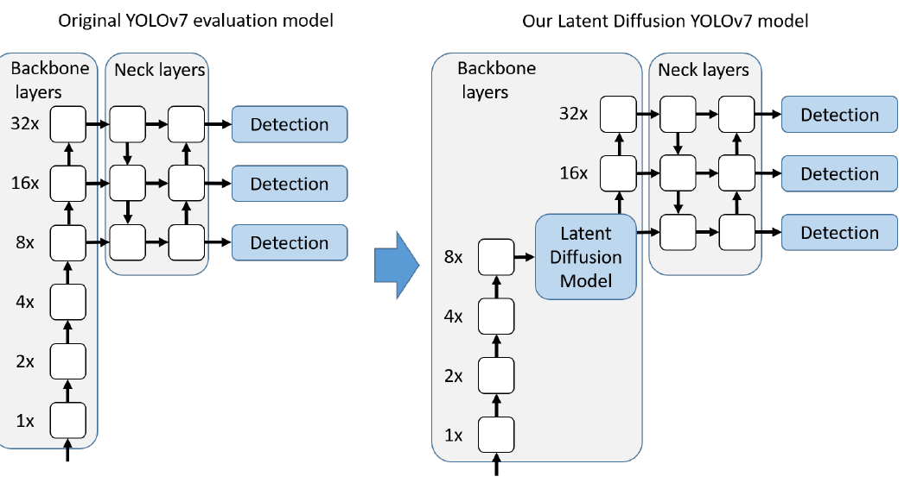
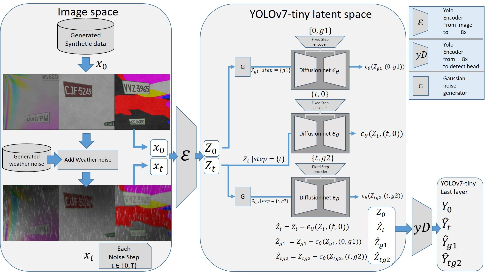

# LD-YOLOv7: License Plate Recognition in Low-Quality Images

**English** | [中文](#中文說明)

Official code for the paper
**[License plate recognition in low quality image by using Latent Diffusion YOLOv7](https://ieeexplore.ieee.org/document/10605244)**
Yu-Hsi Chen\*, Cheng-Jung Chuang\*, Chien-Yao Wang, Jen-Chun Lin, Hong-Yuan Mark Liao
*2024 IEEE Conference on Artificial Intelligence (CAI 2024), pp. 831–838* (\* equal contribution)

---

## Method overview



A latent diffusion model is inserted at the 8× layer of YOLOv7-tiny (between backbone and neck). It restores the **features** of a degraded plate (rain, dark light, glare, gamma, blur) to clean-plate features, and the rest of YOLOv7 detects and reads the characters. The detector is trained **only on synthetic plates**.

<details>
<summary><b>Training of the latent diffusion model</b></summary>



</details>

## Main results

Plate recognition rate (%) — a plate counts only if every character is correct.

| Method | Training data | AOLP (normal weather) | WLP (severe weather) |
|---|---|---|---|
| Silva & Jung, ECCV 2018 [*] | real | 74.16 | 20.37 |
| Laroca et al., IET-ITS 2021 [*] | real | **89.97** | 12.96 |
| YOLOv7-tiny | synthetic only | 85.12 | 31.48 |
| YOLOv7-tiny + Cold Diffusion (image space) | synthetic only | 85.35 | 29.63 |
| **LD-YOLOv7 (ours)** | synthetic only | 87.38 | **35.19** |

[*] Reproduced with official weights. The whole AOLP dataset is used for testing. WLP (Weather License Plate) is our dataset of 92 images / 116 plates; every image has at least one severe weather condition (day and night). Methods that score ~99% in their own AOLP settings keep only about 1/5 of that accuracy on WLP.

## Citation

```bibtex
@inproceedings{chen2024ldyolov7,
  author    = {Chen, Yu-Hsi and Chuang, Cheng-Jung and Wang, Chien-Yao and Lin, Jen-Chun and Liao, Hong-Yuan Mark},
  title     = {License plate recognition in low quality image by using Latent Diffusion YOLOv7},
  booktitle = {2024 IEEE Conference on Artificial Intelligence (CAI)},
  pages     = {831--838},
  year      = {2024}
}
```

## Details


License plates captured in real scenes are often degraded by rain, night lighting, glare, blur, or low resolution, which makes character recognition fail.
LD-YOLOv7 restores the image **inside the detector's feature space** instead of restoring pixels:

1. A **YOLOv7-tiny** model detects and classifies each plate character.
2. The network is split at an intermediate layer. A **diffusion model (based on Cold Diffusion)** is trained in this latent feature space to map features of a degraded plate back to the features of a clean plate.
3. The restored features go through the rest of YOLOv7 to produce the final characters.

Two kinds of degradation are modeled during training:
- **t (image space):** real-world degradations such as rain, spotlight / glare, gamma (dark scenes), pixelation, and down-sampling.
- **g (latent space):** Gaussian noise added to the features.

At inference time, the number of steps `t` and `g` are hyperparameters.

Training uses **synthetic Taiwanese license plates** (generator in `_plate/synthesis/`), optionally pasted onto Cityscapes backgrounds. Evaluation uses AOLP and our Weather License Plate (WLP) dataset.

## Repository structure

```
.
├── _yolo/yolov7/                 # YOLOv7 (detector) + validation notebooks
│   ├── train_yolov7_tiny.sh      # step 1: train the character detector
│   ├── models/yolo_with_diffusion.py   # YOLOv7 split into before / after-diffusion parts
│   └── validation_diffusion_latent_2loss_2noise.ipynb   # step 5: testing
├── Cold-Diffusion-Models/
│   └── licenceplate_deaug_yolov7_2noise/   # steps 2–4: diffusion training (main method)
├── _plate/
│   ├── synthesis/                # synthetic Taiwanese plate generator
│   ├── AOLP/                     # AOLP labels (AC / LE / RP)
│   ├── weather/                  # WLP (weather) dataset info (Day / Night / Rainy)
│   └── ALPR_benchmark/, survey/  # third-party baselines used for comparison
```

## Training & testing

> Scripts were run on our server, so many paths are absolute (e.g. `/data/licence_plate/...`).
> Please change the dataset and model paths in each `.sh` / notebook before running.

| Step | What it does | Script |
|---|---|---|
| 1 | Train the YOLOv7-tiny character detector | `_yolo/yolov7/train_yolov7_tiny.sh` |
| 2 | Train an image-space diffusion (uses the detector's `state_dict` from step 1) | `Cold-Diffusion-Models/licenceplate_deaug_yolov7_2noise/train_yolov7_512_aug_in_dataloader_2loss_image_space.sh` |
| 3 | Train the latent-space diffusion (main method): image *x* → feature *z*, diffusion in *z*, with image-space noise *t* and latent Gaussian noise *g* | `.../train_yolov7_512_aug_in_dataloader_2loss_t100_g10.sh` |
| 4 | Noise interpolation variant: interpolate in latent space from the clean feature to the degraded feature by `g` step, and learn to go back to the clean feature | `.../train_yolov7_512_aug_in_dataloader_noise_interpolation.sh` |
| 5 | Testing (choose `t` and `g` steps here) | `_yolo/yolov7/validation_diffusion_latent_2loss_2noise.ipynb` |

## Acknowledgements

This project builds on [YOLOv7](https://github.com/WongKinYiu/yolov7) and [Cold Diffusion](https://github.com/arpitbansal297/Cold-Diffusion-Models). Thanks to the authors.

---

<a id="中文說明"></a>

# 中文說明

[English](#ld-yolov7-license-plate-recognition-in-low-quality-images) | **中文**

論文官方程式碼：
**[License plate recognition in low quality image by using Latent Diffusion YOLOv7](https://ieeexplore.ieee.org/document/10605244)**
（IEEE CAI 2024，第 831–838 頁）

## 方法圖、主要結果、引用

請見上方 [Method overview](#method-overview)、[Main results](#main-results)、[Citation](#citation)。

重點：只用合成車牌訓練。在惡劣天候資料集 WLP 上，車牌辨識率 **35.19%**，高於 YOLOv7-tiny（31.48%）與用真實資料訓練的方法（20.37%、12.96%）；在一般天候的 AOLP 上為 87.38%（YOLOv7-tiny 85.12%）。

## 簡介

實際場景拍到的車牌常因下雨、夜間、強光、模糊或解析度低而辨識失敗。
LD-YOLOv7 不在像素上修復影像，而是**在偵測模型的特徵空間裡修復**：

1. 用 **YOLOv7-tiny** 偵測並辨識車牌上的每個字元。
2. 把網路從中間層切開，在這個特徵空間訓練一個 **擴散模型（以 Cold Diffusion 為基礎）**，把「劣化車牌的特徵」還原成「清晰車牌的特徵」。
3. 還原後的特徵再送進 YOLOv7 後半段，輸出字元結果。

訓練時模擬兩種劣化：
- **t（影像空間）**：下雨、光斑／眩光、伽瑪（暗場景）、像素化、降解析度等真實劣化。
- **g（特徵空間）**：在特徵上加高斯雜訊。

推論時 `t`、`g` 的步數是可調的超參數。

訓練資料是**合成的台灣車牌**（產生器在 `_plate/synthesis/`），可再貼到 Cityscapes 背景上；測試使用 AOLP 與我們建立的 Weather License Plate（WLP）惡劣天候資料集。

## 資料夾結構

```
.
├── _yolo/yolov7/                 # YOLOv7 偵測模型 + 驗證 notebook
│   ├── train_yolov7_tiny.sh      # 步驟 1：訓練字元偵測模型
│   ├── models/yolo_with_diffusion.py   # 把 YOLOv7 切成擴散前／後兩段
│   └── validation_diffusion_latent_2loss_2noise.ipynb   # 步驟 5：測試
├── Cold-Diffusion-Models/
│   └── licenceplate_deaug_yolov7_2noise/   # 步驟 2–4：擴散模型訓練（主要方法）
├── _plate/
│   ├── synthesis/                # 台灣車牌合成程式
│   ├── AOLP/                     # AOLP 標註（AC / LE / RP）
│   ├── weather/                  # WLP 天候資料集資訊（Day / Night / Rainy）
│   └── ALPR_benchmark/, survey/  # 比較用的第三方方法
```

## 訓練與測試

> 腳本是在實驗室伺服器上執行的，很多路徑是絕對路徑（例如 `/data/licence_plate/...`）。
> 執行前請先修改各 `.sh`／notebook 裡的資料與模型路徑。

| 步驟 | 內容 | 腳本 |
|---|---|---|
| 1 | 訓練 YOLOv7-tiny 字元偵測模型 | `_yolo/yolov7/train_yolov7_tiny.sh` |
| 2 | 訓練影像空間的擴散模型（使用步驟 1 的 `state_dict`） | `Cold-Diffusion-Models/licenceplate_deaug_yolov7_2noise/train_yolov7_512_aug_in_dataloader_2loss_image_space.sh` |
| 3 | 訓練特徵空間的擴散模型（主要方法）：影像 *x* → 特徵 *z*，在 *z* 做擴散；雜訊包含影像空間 *t* 與特徵空間高斯雜訊 *g* | `.../train_yolov7_512_aug_in_dataloader_2loss_t100_g10.sh` |
| 4 | 雜訊內插版本：在特徵空間依 `g` 步數，從清晰特徵內插到劣化特徵，再學習還原回清晰特徵 | `.../train_yolov7_512_aug_in_dataloader_noise_interpolation.sh` |
| 5 | 測試（在這裡設定 `t`、`g` 步數） | `_yolo/yolov7/validation_diffusion_latent_2loss_2noise.ipynb` |

## 致謝

本專案以 [YOLOv7](https://github.com/WongKinYiu/yolov7) 與 [Cold Diffusion](https://github.com/arpitbansal297/Cold-Diffusion-Models) 為基礎，感謝原作者。
